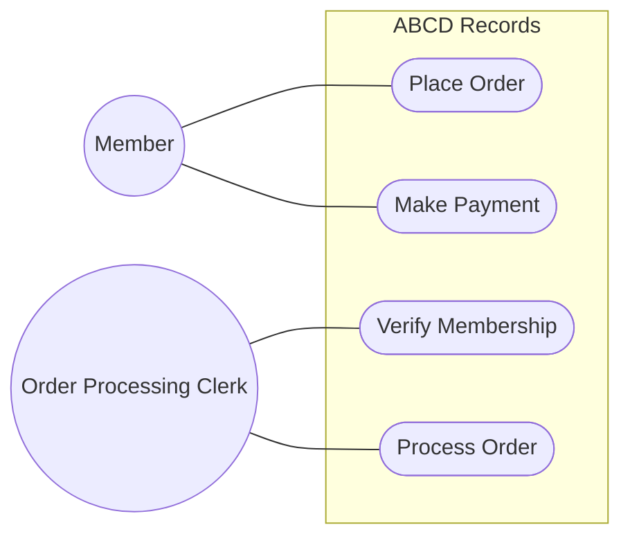
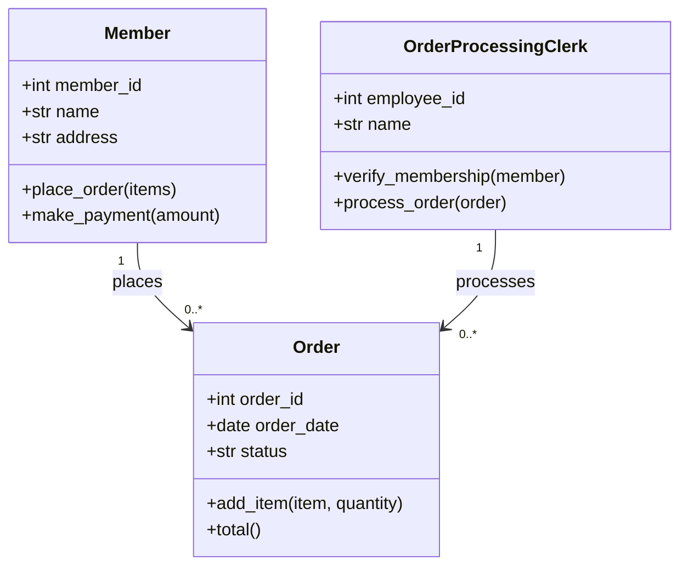
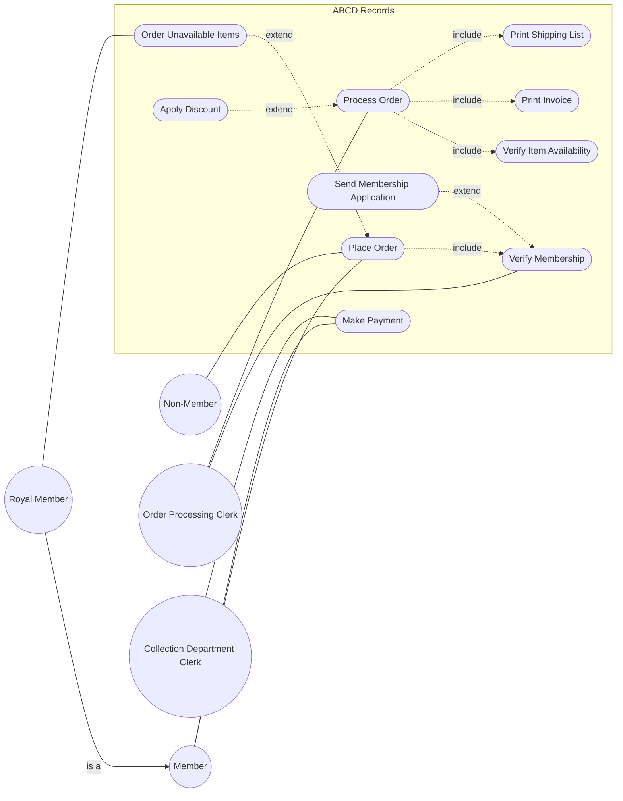
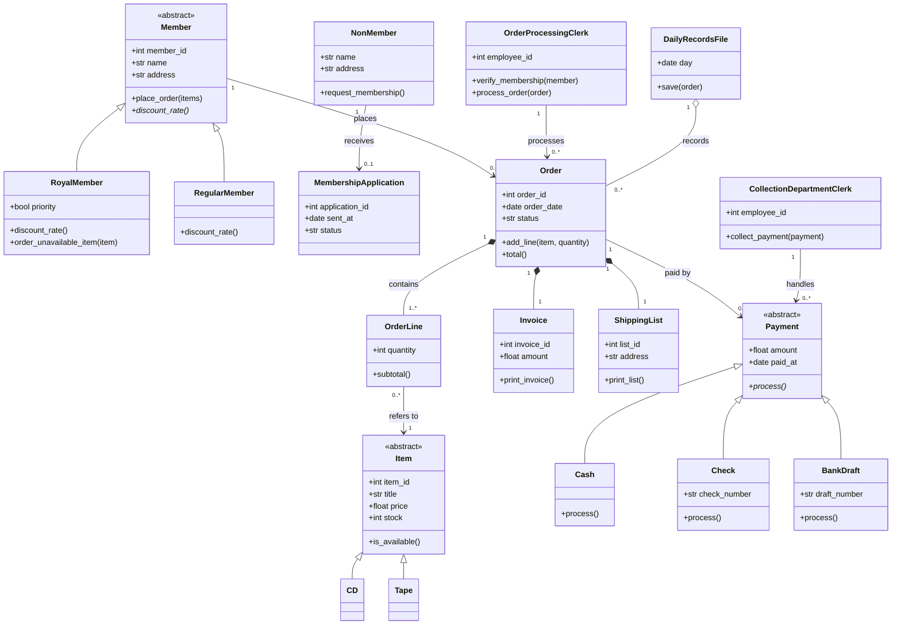
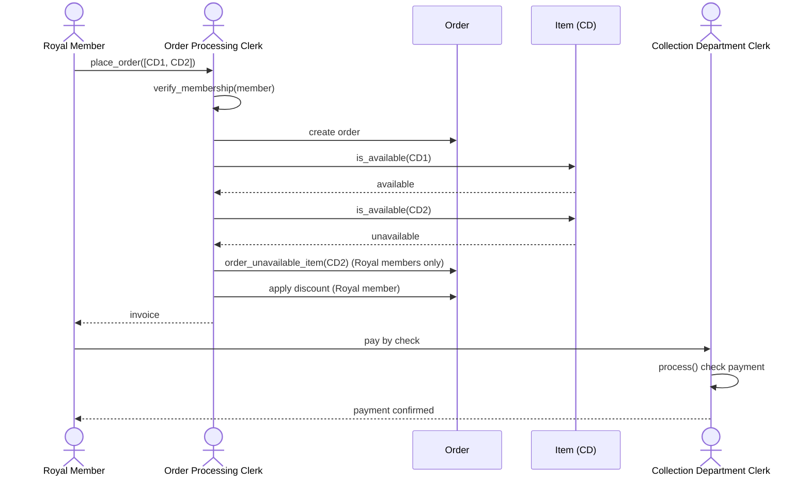
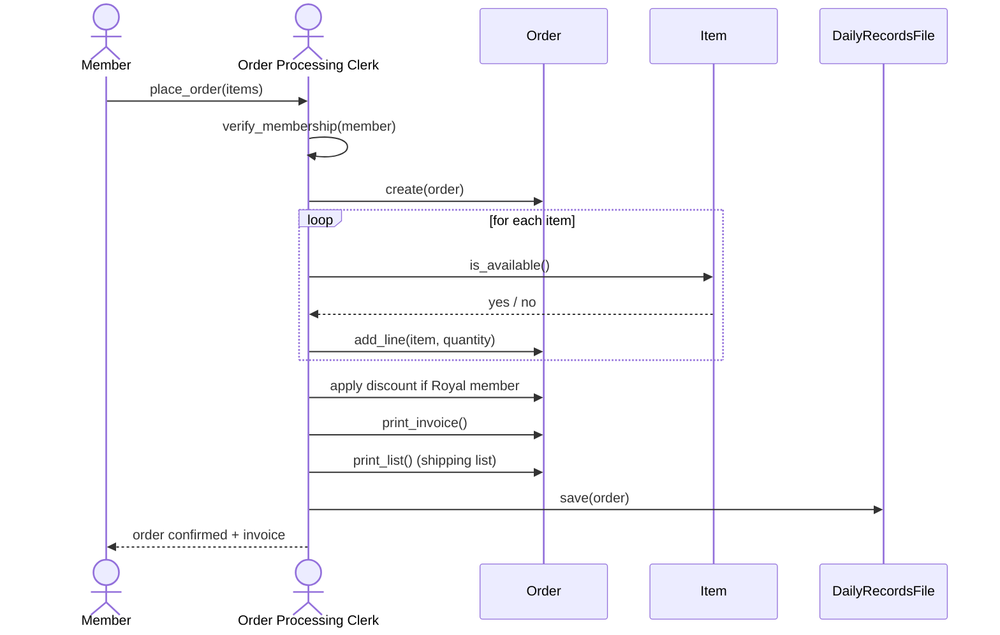
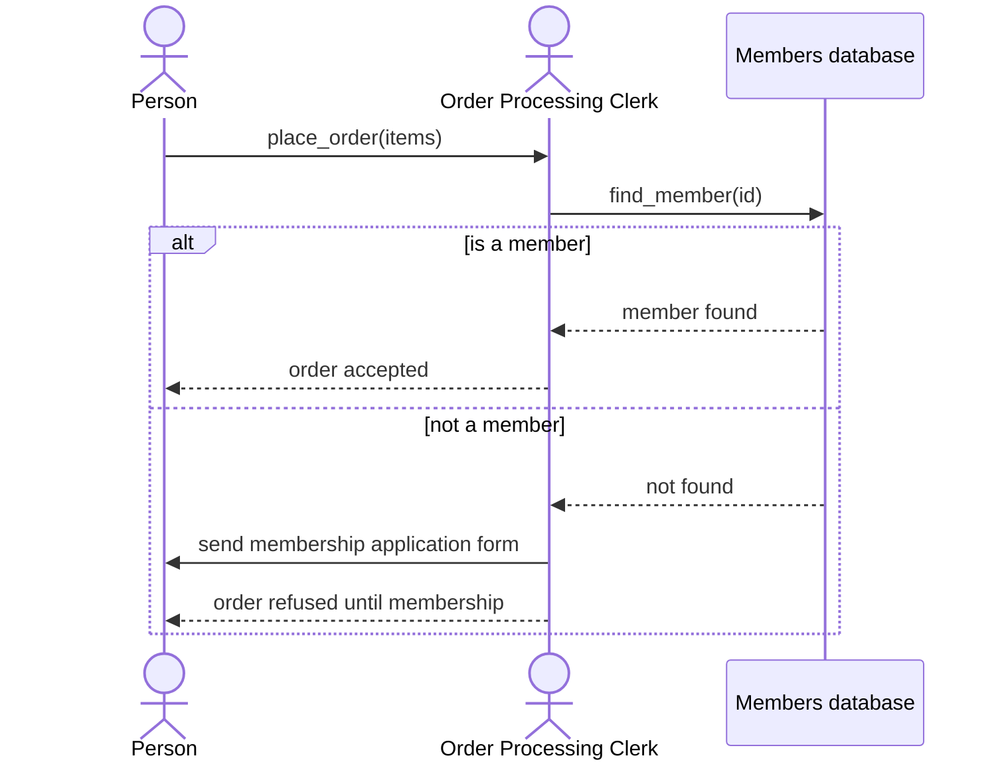
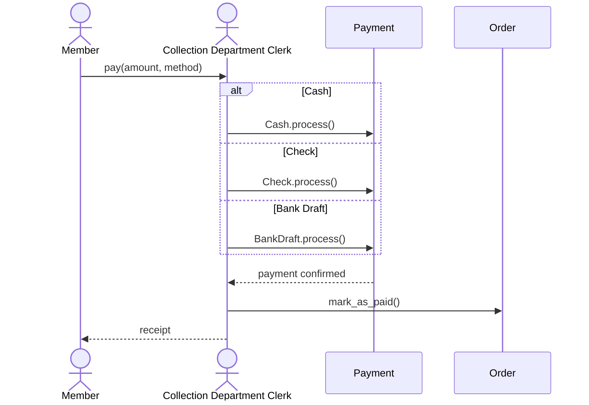
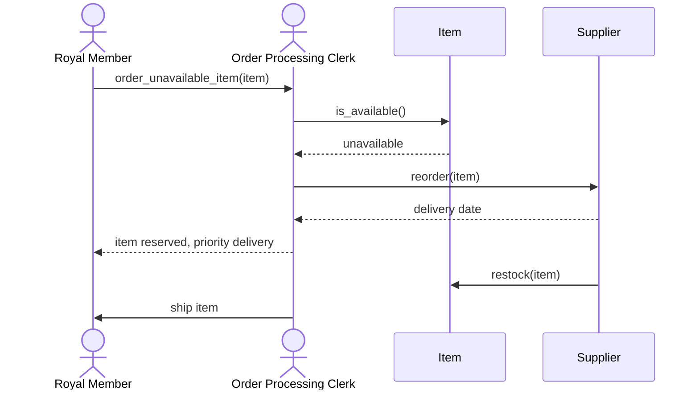

# Exo 2 – ABCD Records 📼

> Note: Mermaid has no dedicated use case diagram, so use case diagrams are drawn with a flowchart:
> actors are circles, use cases are rounded boxes inside the system boundary, and `include` / `extend` are dotted arrows.

## Level 1

### Task 1.1 – Simple use case diagram

### Task 1.2 – Basic class diagram

## Level 2

### Task 2.1 – Complete use case diagram

- **include** (always happens): placing an order always verifies membership; processing an order always checks availability and prints the invoice and the shipping list.
- **extend** (only sometimes): a discount applies only to Royal members; ordering unavailable items is only for Royal members; the membership application is only sent when the person is not a member.
- A Royal Member is a kind of Member (actor generalization).

### Task 2.2 – Complete class diagram

- **Member types**: `Member` is abstract, `RoyalMember` (discounts, priority, can order unavailable items) and `RegularMember` inherit from it.
- **Payment types**: `Payment` is abstract with `process()`, implemented by `Cash`, `Check` and `BankDraft`.
- **Item types**: `Item` is abstract, `CD` and `Tape` inherit from it.
- An `Order` is **composed of** one or more `OrderLine`s (filled diamond: the lines don't exist without their order); each line refers to one `Item`.
- Each order produces exactly one `Invoice` and one `ShippingList` (composition), and is saved in the `DailyRecordsFile`.

### Scenario – a Royal member orders 2 CDs (one unavailable) and pays by check

## Level 3 – Advanced sequence diagrams

### Complete order processing flow

### Membership verification (success and failure)

### Payment processing (all types)

### Item reordering for Royal members

