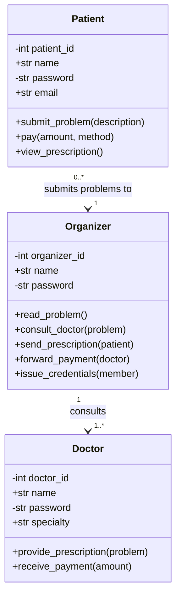
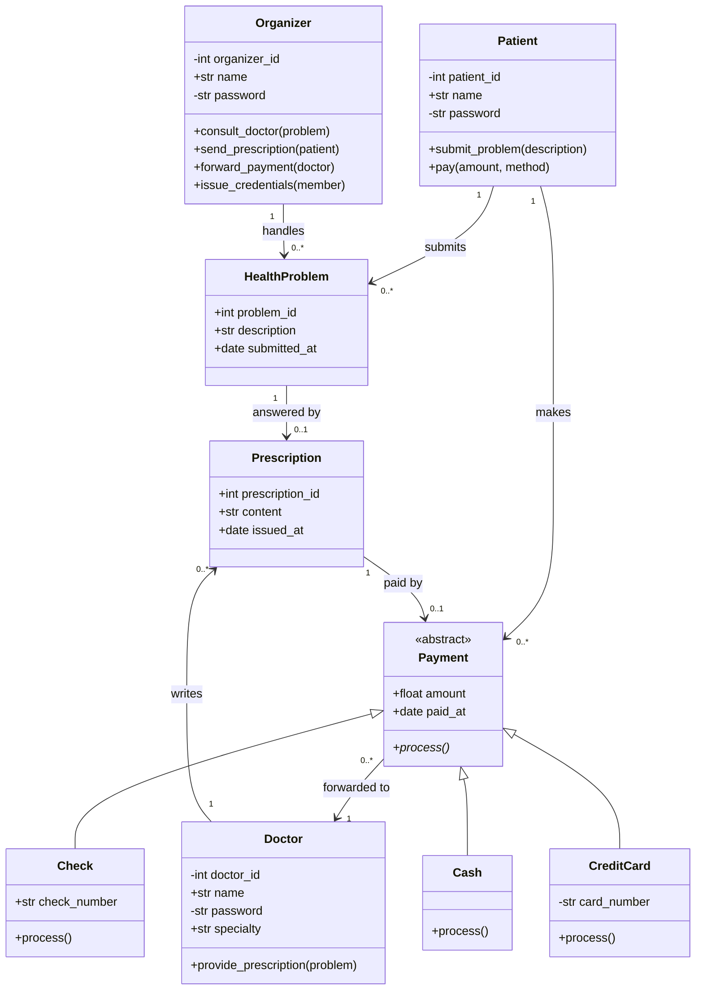
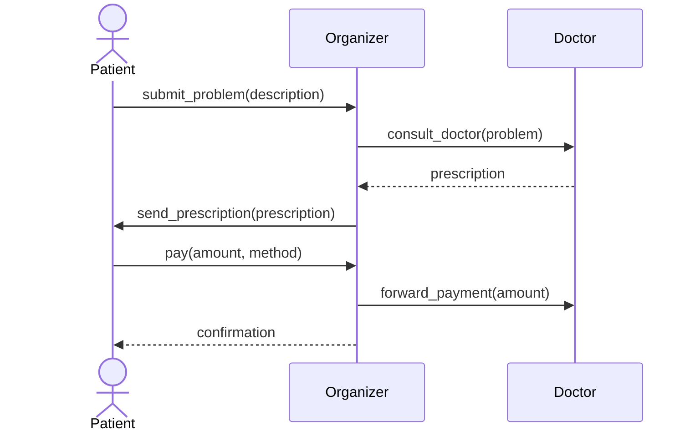
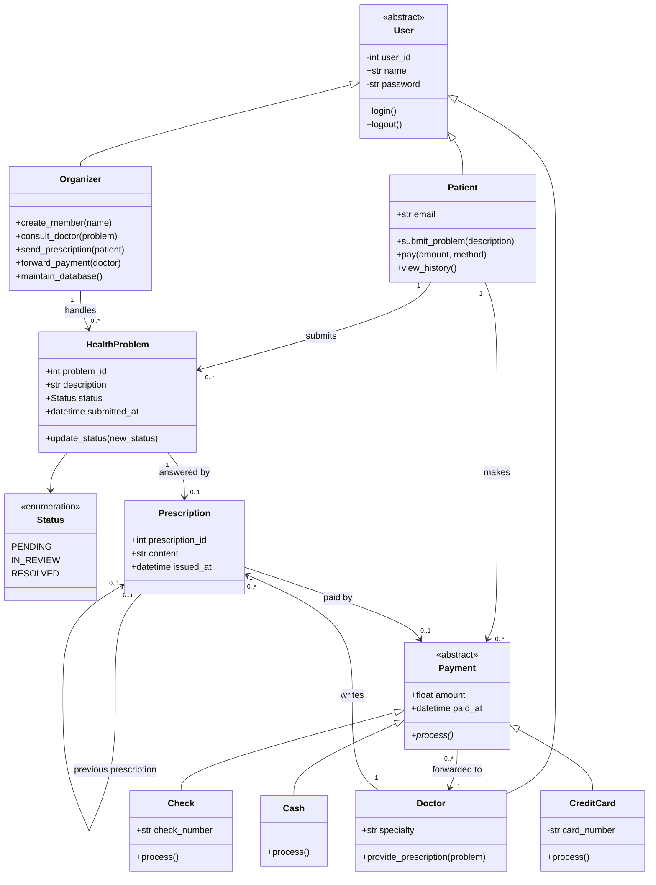
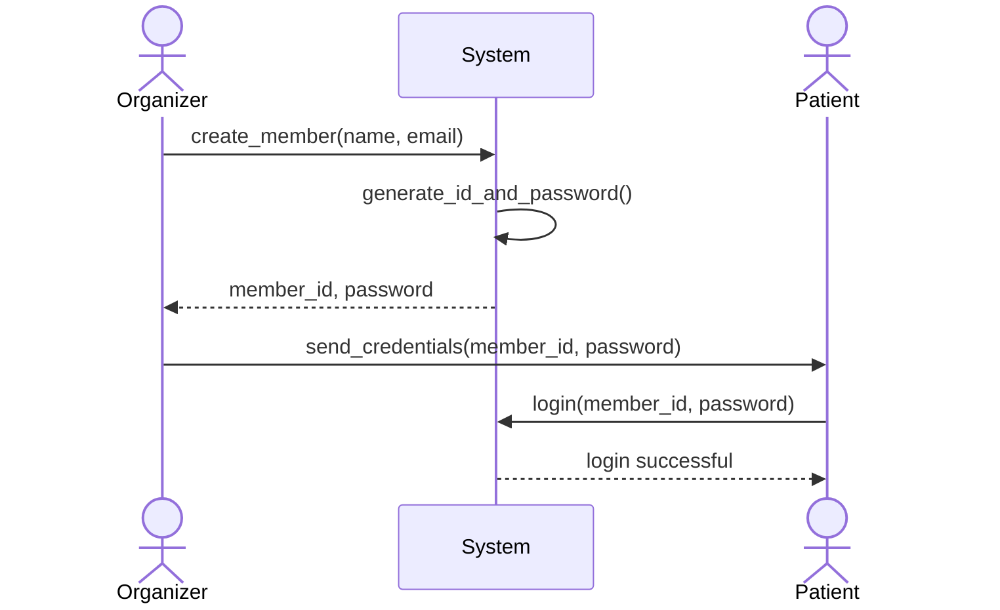
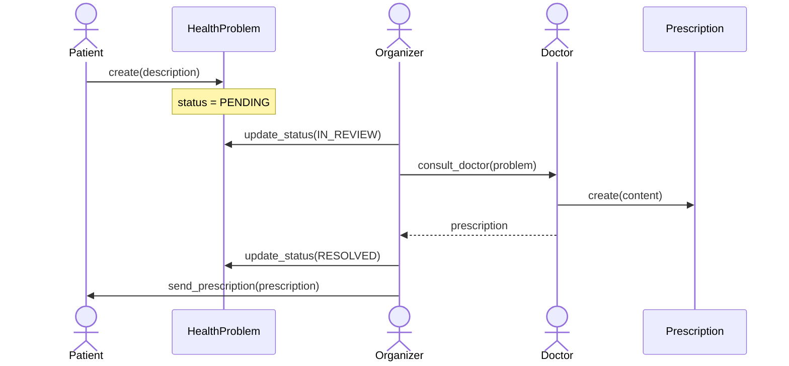
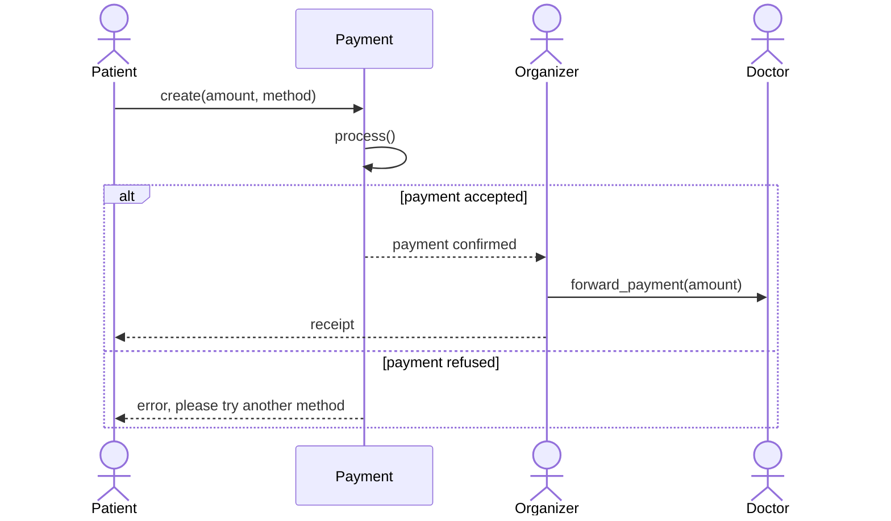

# Exo 1 – Hospital Management System 🏥

## Task 1 – Basic class diagram

Each actor of the platform becomes a class. The Patient submits problems to the Organizer, and the Organizer consults one or more Doctors.

## Task 2 – Complete class diagram (6 classes)

- A Patient submits 0 or more HealthProblems; a HealthProblem belongs to exactly 1 Patient.
- A Doctor writes Prescriptions; each Prescription answers exactly 1 HealthProblem.
- A Payment pays exactly 1 Prescription and is made by 1 Patient.
- Payment types use **inheritance**: Payment is abstract and each type implements `process()` in its own way.

### Sequence diagram – one patient submits a problem, receives a prescription, and pays

## Task 3 – Advanced

Additions compared with Task 2:
- a **User** superclass for the shared attributes (id, name, password) and `login()` / `logout()`;
- the payment strategy modelled with **polymorphism** (abstract `Payment.process()`);
- **status tracking** for HealthProblem with a `Status` enumeration (pending, in-review, resolved);
- **timestamps** (`submitted_at`, `issued_at`, `paid_at`) and a reference to a **past prescription**.

### System sequence diagram 1 – Patient registration (the Organizer creates a new member)

### System sequence diagram 2 – Consultation flow (from problem submission to prescription delivery)

### System sequence diagram 3 – Payment processing (the patient pays, the organizer forwards to the doctor)

## Questions to consider

**How would you handle a patient consulting multiple doctors?**
A patient can have several HealthProblems (Patient 1 → 0..* HealthProblem), and each problem gets a Prescription written by a Doctor. So a patient with several problems can see several doctors. If one single problem needs several doctors, the multiplicity becomes HealthProblem 1 → 0..* Prescription.

**Should prescriptions be reusable? How would you model that?**
Past prescriptions are kept with their date, linked to the patient's previous health problems, so they form a history. A new prescription can reference a past one with the self-association `previous prescription` (0..1), for example to renew a treatment.

**What design pattern fits the payment system?**
The **Strategy** pattern: `Payment` is an abstract strategy with `process()`, and `Check`, `Cash` and `CreditCard` are interchangeable concrete strategies. A new payment method can be added without modifying the existing classes (Open/Closed principle).

**How do you ensure data integrity when payments are processed?**
Validate the payment before processing it (amount greater than 0, valid card or check), keep sensitive data private (encapsulation: `-card_number`, `-password`), only forward the money to the doctor once the payment is confirmed, and record every payment with a timestamp so it can be traced.
